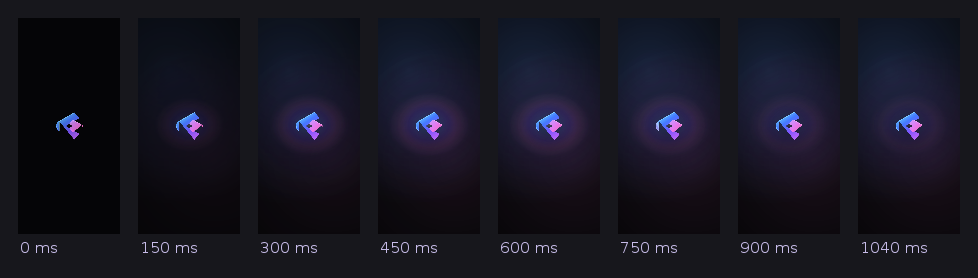

# CineMax

Movie streaming PWA built with Next.js 16, PostgreSQL and Drizzle ORM.

## Local development

```bash
npm install
cp .env.example .env.local   # then fill in the values
npm run dev
```

Open http://localhost:3000. On first visit the app creates the database tables if they are missing. Nothing is seeded: movies, slides and categories are managed exclusively from the studio (`/gate-keeper`), and the admin panel is the single source of truth for the public catalogue.

## Deploy to Vercel

1. **Create a PostgreSQL database**: Neon (Vercel → Storage → Neon), Supabase, Railway, etc. Copy its connection string.
2. **Import the repo** in Vercel. The framework preset should be **Next.js**. Leave the build command (`next build`) and output directory at their defaults.
3. **Add environment variables** (Project → Settings → Environment Variables, for Production *and* Preview):

   | Name             | Value                                                    |
   | ---------------- | -------------------------------------------------------- |
   | `DATABASE_URL`   | your Postgres connection string                          |
   | `JWT_SECRET`     | a long random string (`openssl rand -base64 32`)         |
   | `ADMIN_EMAIL`    | admin login email for `/gate-keeper`                     |
   | `ADMIN_PASSWORD` | admin login password                                     |

   If you used Vercel's Neon integration, `POSTGRES_URL` / `DATABASE_URL` is added for you. Both names work.
4. **Redeploy** (Deployments → ⋯ → Redeploy) so the new variables take effect.
5. Open the site and sign in to the studio (`/gate-keeper`) to add your movies and homepage slides. The tables are created on first visit; no demo data is ever inserted automatically. (`POST /api/seed` only checks the schema — it never writes catalogue rows.)
6. Check the database connection at `https://YOUR-APP.vercel.app/api/health`. It should return `{"ok":true}`.

### Optional: manage the schema with Drizzle

```bash
DATABASE_URL="postgresql://..." npm run db:push    # create/update tables
DATABASE_URL="postgresql://..." npm run db:studio  # browse data
```

## Existing data, schema drift and diagnostics

The app never assumes your database was created by this exact revision. On the
first request of each server process it reconciles the schema **without dropping
anything**:

| Situation                                       | What happens                                              |
| ----------------------------------------------- | --------------------------------------------------------- |
| Table missing                                   | created from `src/db/schema.ts`                           |
| Column the mapping expects is missing           | added (`ADD COLUMN IF NOT EXISTS`)                        |
| Column exists under an older name (`poster`)    | renamed onto the expected name (`poster_url`), data kept  |
| Old and new column both exist                   | values copied into the new column where it is empty       |

The old names it recognises live in `src/db/table-map.ts`. Nothing is deleted and
no data is rewritten unless the target column is empty.

`GET /api/health` reports the whole chain instead of just the TCP connection:

```jsonc
{
  "ok": true,
  "connection": { "host": "ep-…neon.tech", "database": "neondb", "ssl": true, "source": "DATABASE_URL" },
  "tables": { "movies": { "created": false, "added": ["featured"], "renamed": [{ "from": "poster", "to": "poster_url" }], "backfilled": [], "skipped": [] } },
  "counts": { "movies": 32, "slides": 3, "categories": 12 }
}
```

When `ok` is `false`, `stage` says which step failed (`connect`, `schema` or
`read`) and `error` carries the Postgres message — e.g.
`column "poster_url" of relation "movies" does not exist`. The admin panel shows
the same message in a banner rather than rendering an empty library.

## Catalogue ownership and demo-catalog cleanup

The studio (`/gate-keeper`) is the only writer of movies, slides and
categories. There is no automatic catalogue seeding or synchronisation anywhere
in the app: nothing re-inserts deleted titles, overwrites admin edits, or
substitutes a hardcoded catalog when the database is empty — the public app
shows an explicit empty state instead.

Deployments that still contain rows from the old hardcoded demo catalog can
remove exactly those rows with the guarded cleanup script. It identifies a
record as demo content only when its title/year **and** its stored video or
poster URL match `scripts/demo-catalog-manifest.json`, writes a full JSON
backup of the movies/slides/categories tables before deleting anything, and
changes nothing in its default dry-run mode:

```bash
# 1. See what would be removed (changes nothing)
DATABASE_URL="postgresql://..." node scripts/cleanup-demo-catalog.mjs

# 2. Back up (./backups/cinemax-backup-<timestamp>.json) and delete only those rows
DATABASE_URL="postgresql://..." node scripts/cleanup-demo-catalog.mjs --apply
```

Admin-created records are preserved even when they share a title with a demo
entry, as long as their own source/poster differs. Note that the original
pre-demo production data is **not** stored in this repository (no database
backup is committed), so rows the old sync already destroyed in a live
database can only be restored from that database provider's own backups
(e.g. Neon/Supabase point-in-time recovery); the cleanup script never invents
replacement content.

## Playback and authorized magnet sources

Cinemax keeps direct MP4/WebM URLs, HLS (`.m3u8`), YouTube, and Vimeo playback. HLS uses `hls.js` on compatible browsers for adaptive buffering and selectable renditions; Safari/iOS can use native HLS. The player also supports WebVTT subtitle tracks, speed and picture controls, keyboard shortcuts, recoverable network/media errors, and a private per-device resume marker (stored locally in the browser).

Magnet sources are an opt-in path for **content Cinemax is authorized to distribute**:

1. In `/gate-keeper`, paste the licensed `magnet:?xt=urn:btih:…` or v2 magnet URI into a movie’s Playback source field.
2. Confirm the public distribution-rights checkbox. The API rejects magnet sources without this attestation, and the public catalogue never returns the magnet itself.
3. Deploy a private, persistent torrent streaming gateway and set `TORRENT_STREAMING_ENABLED=true`, `TORRENT_GATEWAY_URL`, and a long random `TORRENT_GATEWAY_TOKEN`. The gateway must stream the selected video file as soon as pieces are available; it must not require the viewer to wait for the whole torrent.

The Cinemax `/api/stream/{movieId}` Node route is the public playback endpoint and security boundary: it only resolves magnets already saved to an authorized movie, keeps the source server-side, forwards byte-range requests for seeking/buffering, and streams the gateway response through without buffering the whole file in Next.js. It returns `503` when magnet streaming is not configured. The gateway must be private, use HTTPS outside localhost, validate the bearer token, choose a video file only, support `GET`/`HEAD` and HTTP `Range` (including `206`, `Content-Range`, and `416`), and return a streaming response with `Content-Length`/`Accept-Ranges` where available. The private `X-Cinemax-Authorized-Magnet` header contains the approved source; do not log that header or expose the gateway directly to browsers.

**Deployment note:** the torrent engine is intentionally a separately operated persistent service rather than a torrent client embedded in a serverless Next.js function. Vercel can host the Cinemax UI/API adapter, but it cannot host the always-on peer discovery and stream lifecycle needed by a torrent engine. If you do not operate an authorized gateway, leave `TORRENT_STREAMING_ENABLED=false`; direct video and HLS playback are unaffected. The app does not supply, index, seed, or recommend any torrent content.

## Scripts

| Script              | What it does                                                       |
| ------------------- | ------------------------------------------------------------------ |
| `npm run dev`       | Start dev server                                                   |
| `npm run build`     | Production build                                                   |
| `npm run lint`      | ESLint                                                             |
| `npm run typecheck` | TypeScript check                                                   |
| `npm run test:ui`   | API-backed Playwright regression checks (desktop/mobile/reduced motion) |
| `npm run test:ui:report` | Open the latest browser-check report                          |
| `npm run db:push`   | Push Drizzle schema to database                                    |
| `npm run verify:api`| End-to-end check of every admin/public API route (see below)        |
| `npm run verify:logos` | Brand-artwork integrity (19 platforms, pinned originals)        |
| `npm run verify:platforms` | Platform registry, save/read path and tokens              |
| `npm run verify:share` | Sharing rules: one link, one card, no deployment hostname, native bridge and Web Share |
| `npm run verify:legal` | The five legal documents' rendered HTML (run after `npm run build`) |
| `npm run verify:promo` | The first-visit app promotion and the APK it hands out (package id, version, signature) |
| `npm run measure:playback` | Playback-resolver timings against a local fixture provider |
| `npm run measure:player` | Time from "play" to the player element, cold vs. warmed on intent |
| `npm run licenses`  | Dependency licence report (`-- --json` or `-- --csv`)              |

### Verifying a deployment

`scripts/verify-admin.mjs` logs in, then exercises every read and every
add/edit/delete path (movies, slides, categories, watchlist) plus the auth and
validation guards. It creates its own rows and deletes them again, so it is safe
to run against a database that already holds data.

```bash
# against a local dev server
npm run dev &
BASE_URL=http://localhost:3000 ADMIN_EMAIL=admin@cinemax.com ADMIN_PASSWORD=... npm run verify:api

# against a deployment
BASE_URL=https://your-app.vercel.app ADMIN_EMAIL=... ADMIN_PASSWORD=... npm run verify:api
```

It prints one line per check and exits non-zero if anything fails.

## Legal documents (website only)

Five long-form documents live on the website:

| Route | Document |
| ----- | -------- |
| `/license` | Licensing & attribution — all nineteen platform marks, their owners, software, fonts, artwork and the "no affiliation" disclaimer |
| `/copyright` | Copyright & intellectual property |
| `/attributions` | Third-party attributions — dependency licences and what each is used for |
| `/disclaimer` | Content & trademark disclaimer |
| `/privacy` | Privacy and content usage — the real storage keys, cookies, third-party hosts and Android permissions |

They share one chrome (`src/components/LegalDocument.tsx`), one content source
(`src/lib/legal.ts`) and one stylesheet block in `src/app/globals.css`. They are
reached from the footer of the home page and from each other.

**They are website-only.** The Android app cancels those five paths
(`NavigationPolicy.isWebsiteOnlyPath`), removes the footer row
(`app-theme.css`) and sends a deep link to one of them to the home surface, so
the legal section cannot appear inside the app.

```bash
npm run build && npm run verify:legal   # checks the rendered HTML of all five
npm run licenses                        # dependency licence report
```

## Sharing a title

The Share button on a title screen, and the share control on `/share/<id>`, run
one code path (`src/lib/share.ts`). A share carries **one** link and **one** card:
the link is the destination (`https://cinemaxtv.space/share/<id>`, never a
deployment hostname), the receiving app renders the card from that page's Open
Graph tags, and the message text is the title's description — not a second copy
of the title, not a raw address, not a trailer URL.

* inside the Android app it calls the native bridge, which opens Android's own
  `Intent.createChooser` sheet — every installed app that accepts a share is
  listed, nothing is hardcoded. The generated card is attached as a
  `content://` URI when it is already cached, and the sheet never waits for a
  download (a fresh card gets 1.5 s and then finishes in the background);
* in a browser it uses the Web Share API and copies description + link when
  sharing is not available; nothing is downloaded before the sheet opens;
* the link opens `/share/<id>`, which shows the title's own poster, backdrop,
  name, type, year, genre and synopsis, a playable trailer when the record has a
  video file, and an explicit link to the trailer's host otherwise. A still image
  is never presented as playing video;
* `/api/share/card/<id>` renders the 1200×630 preview card used as
  `og:image`/`twitter:image` (cached `max-age=3600, s-maxage=86400`).

`npm run verify:share` exercises those rules (payload, official origin, bridge
precedence, Web Share, cancellation and clipboard fallback) without a browser or
a device.

## First-visit app promotion and the download

First-time visitors to the website are offered the Android app once: a card in
the corner of the page ("Get this app & enjoy it") with a **Download Android
app** button and **Continue on website**. It never blocks the page, never
downloads anything by itself, and a dismissal is remembered on the device
(`localStorage` plus a 180-day cookie — no database). Android gets the download;
desktop and unsupported devices get an availability note. Inside the app it does
not appear at all.

`/download/android` answers with `public/downloads/Cinemax-1.1.0.apk` directly —
`application/vnd.android.package-archive`, `attachment; filename=…`, no redirect.
`npm run verify:promo` reads the package id, version and signature out of that
file and fails if it disagrees with the site.

## Android app

The repository also ships a real, installable Android app
(`android/dist/Cinemax-1.1.0.apk`, package `com.cinemax.app`). It is a native
shell around this same deployment — `https://cinemaxtv.space` — so the
existing web app, API routes, PostgreSQL data, studio/admin panel, authentication
and playback all run unchanged. The app adds a native splash, app icon, adaptive
+ legacy launcher icons, edge-to-edge inset handling, back-button behaviour,
rotation and fullscreen playback handling, external-link routing, and an
app-only premium presentation layer (its own stylesheet, scoped to the app, that
never affects the website).

The splash shows the existing Cinemax logo and nothing else — no wordmark,
tagline, rings, orbit lines, dots, streaks or spinner — as one composited view on
a deep near-black canvas: the logo dollies in over rising blue/violet/pink light,
a single blue-to-pink band sweeps across it, and the glow settles. It plays only
on a genuine cold launch, hands over as soon as the page has a themed first
paint, and stops drawing frames as soon as it has settled.



```bash
bash android/build.sh            # signed APK → android/dist/Cinemax-1.1.0.apk
bash android/tests/run-tests.sh  # 158 JVM + 64 DOM + 100 APK checks
bash android/tools/preview-splash.sh   # render the splash offline (no device)
adb install -r android/dist/Cinemax-1.1.0.apk
```

Gradle-free and SDK-manager-free: the build fetches a pinned, checksum-verified
toolchain. The same build runs in CI on every push and pull request, and the
finished `Cinemax-1.1.0.apk` (with its SHA-256) is attached to the run as the
`cinemax-android-apk` artifact — download it from the *Actions* tab and open it
on the device. Full details, the design system, device verification steps and
the remaining notes live in [android/README.md](android/README.md).

## Cinemax / Prism visual redesign

The public UI now uses an original multicolour aperture emblem, cinematic
artwork, a session-only intro, flowing SVG button lighting, and persistent
responsive navigation. Existing APIs, database records, studio/authentication,
and playback are retained.

See [the redesign and verification notes](docs/prism-redesign.md) for the design
system, interaction fixes, browser-check setup, and deployment caveats.

## Performance

Render cost is measured, not assumed. `node .perf/run.mjs` mounts the real
catalogue/watchlist providers, a 200-card poster rail and the 19 platform marks
in jsdom against a production React build, replays a scroll gesture and a
catalogue revalidation, and reports commit costs, re-render counts and the image
attributes actually emitted (`--dev` reads `<Profiler>` durations). See
[the render-cost harness](docs/performance.md) for the method, the numbers and
the limits, and [the round 6 report](docs/round6-report.md) for what was fixed.
