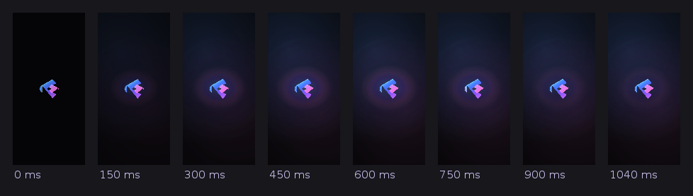
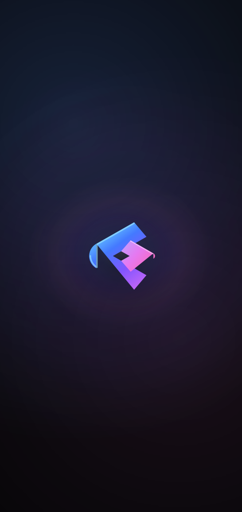

# Cinemax · Android app

The Cinemax Android app is a thin, native shell around the existing production
deployment. It does **not** fork, replace or duplicate anything: the same Next.js
app, the same API routes, the same PostgreSQL database, the same studio/admin
panel, the same authentication and the same playback pipeline run inside the app,
served from **`https://cinemax-orpin.vercel.app`**.

```
android/
├── app/src/main/                 Android application module
│   ├── AndroidManifest.xml       permissions, deep links, single activity
│   ├── java/com/cinemax/app/     activity, theme, bridge, policy, splash (8 files)
│   ├── assets/cinemax/           app-only presentation layer (CSS + runtime)
│   └── res/                      adaptive + legacy icons, splash, themes, layout
├── build.sh                      Gradle-free build → signed APK
├── tools/
│   ├── fetch-toolchain.sh        pinned, checksum-verified tool downloads
│   ├── align_apk.py              zipalign-equivalent alignment (4-byte / 4096-byte)
│   ├── make_legacy_icons.py      raster launcher icons for API 24/25
│   ├── SplashPreview.java        renders the splash offline (no device)
│   └── preview-splash.sh         runs that render: timeline, screens, sweep
├── tests/
│   ├── run-tests.sh              one command runs every layer
│   ├── install-test-deps.sh      installs jsdom for the DOM layer (cached)
│   ├── java/CinemaxAppTest.java  policy, escaping, splash timeline, scroll rules (JVM)
│   ├── shell-dom.test.mjs        the injected layer executed against a DOM
│   ├── apk_check.py              manifest, resources, dex, signature, alignment
│   └── axml.py                   binary AndroidManifest.xml reader
└── dist/                         built artefacts (Cinemax-1.1.0.apk)
```

`.github/workflows/android.yml` builds this same way in CI (no Gradle, no SDK
manager): it fetches the pinned toolchain, installs jsdom, runs
`android/build.sh`, then `android/tests/run-tests.sh`, and uploads
`Cinemax-1.1.0.apk` plus its `.sha256` as the `cinemax-android-apk` artifact.
Every push and pull request builds it, and the workflow can be started by hand
with *Run workflow*.

## Build

```bash
bash android/build.sh              # build, sign and verify  →  android/dist/Cinemax-1.1.0.apk
bash android/build.sh --no-verify  # skip the verification pass
bash android/tests/run-tests.sh    # build if needed, then run all checks
bash android/tests/run-tests.sh --skip-build
```

The first build downloads a pinned toolchain into `android/.toolchain/`
(git-ignored) and verifies every archive's SHA-256:

| Tool                   | Source                                   | Used for                       |
| ---------------------- | ---------------------------------------- | ------------------------------ |
| `aapt2` 2.19-7832930   | PyPI `aapt2`                             | resource compilation + linking  |
| Android API 34 jar     | npm `@drxiaozhi/minapk`                  | `javac`/D8 boot and library jar |
| `d8.jar` (R8)          | npm `@drxiaozhi/minapk`                  | Java bytecode → `classes.dex`   |
| `ecj-3.45.0.jar`       | npm `@drxiaozhi/minapk`                  | Java compiler (`-source 8`)     |
| `apksigner.jar`        | npm `@drxiaozhi/minapk`                  | v1 + v2 + v3 signing            |
| Temurin 25 (jdk4py)    | PyPI `jdk4py`                            | JRE + `keytool`                 |

No Gradle, no Android SDK manager, no Android Studio. Override any tool with
`CINEMAX_JAVA`, `CINEMAX_KEYTOOL`, `CINEMAX_AAPT2`, `CINEMAX_ANDROID_JAR`,
`CINEMAX_D8_JAR`, `CINEMAX_ECJ_JAR`, `CINEMAX_APKSIGNER_JAR`.

**Signing.** `android/keystore/cinemax-release.keystore` (PKCS12, alias
`cinemax`) holds the self-signed release key; store and key password default to
`cinemax-release`. Override with `CINEMAX_KEYSTORE`, `CINEMAX_KEY_ALIAS`,
`CINEMAX_KEY_PASS`, `CINEMAX_STORE_PASS`. **Replace this keystore with your own
before publishing to Play** – the signing key decides upgrade identity:

```bash
CINEMAX_KEYSTORE=/secure/cinemax.jks CINEMAX_KEY_ALIAS=cinemax \
CINEMAX_KEY_PASS='…' CINEMAX_STORE_PASS='…' bash android/build.sh
```

Play requires an `.aab`; this project produces an installable, signed `.apk`.
The same sources build an AAB with any standard Android toolchain (Android
Studio → *Build → Generate Signed Bundle*), since `app/` is a normal Android
module layout.

## Install

```bash
adb install -r android/dist/Cinemax-1.1.0.apk
```

Or copy the APK to the device and open it (enable *Install unknown apps* for the
file manager/browser you use). Requirements: **Android 7.0 (API 24) or newer**,
`targetSdk 34`. Two permissions only: `INTERNET` and `ACCESS_NETWORK_STATE`.

## What the app does

| Concern | Behaviour |
| --- | --- |
| Content origin | `https://cinemax-orpin.vercel.app` only – never localhost, never an emulator host, never a dev server. The URL is compiled into `classes.dex` and asserted by the tests. |
| In-app navigation | The production host and its `*.vercel.app` aliases stay in the WebView, so tabs, filters, search, details, watchlist, studio login, cookies and the whole player behave exactly as in a browser. |
| External links | Any other domain, plus `mailto:`, `tel:`, `sms:`, `market:`, `intent:` and unknown schemes open in the matching system app. A lookalike host such as `evil-vercel.app.attacker.com` is sent out, not loaded. |
| Deep links | `https://cinemax-orpin.vercel.app/...` opens inside the app (`autoVerify`, see below). Re-opening from the launcher keeps the page you were on. |
| Back button | Fullscreen video → leave fullscreen; error screen → dismiss; otherwise WebView history → then "Press back again to exit". |
| Rotation | The activity handles configuration changes itself, so rotating (or the player switching to landscape) never reloads the page. |
| Edge to edge | API 30+ draws behind transparent status/navigation bars; the real insets are measured natively and published to the page as CSS variables, so the existing layout clears the status bar, gesture bar, cutout and rounded corners. Themed brand gradient shows in the very top and bottom strips. |
| Keyboard | `adjustResize` + IME padding, so the studio forms are never hidden behind the keyboard. |
| Playback | Media autoplay is permitted, HLS/MSE run in-page, and the Cinemax player bridge puts direct video into immersive **sensor-landscape** fullscreen. Exit (or Android Back) restores the prior orientation and normal system bars; the screen stays awake only while media is actually playing. |
| Session intro | The native splash shows **one thing: the Cinemax logo**. No wordmark, tagline, ring, orbit line, dot, streak, ripple or spinner appears in it. It is drawn by one composited view: the logo dollies from the size the launch window left it at, the blue/violet/pink lighting behind it rises and blooms, a single blue-to-pink light band sweeps across the logo, and the glow eases back onto its resting level (1.04 s, after which the view stops drawing frames entirely). It plays **only on a genuine cold launch of the process**, hands over as soon as the logo has landed, the light has crossed it and the page has a themed first paint (a 320 ms cross-fade on the render thread), and shows no loading screen. A re-entry, a restore, an offline retry or a renderer restart shows the finished logo as a still frame instead of replaying the animation. |
| Crash resilience | If the WebView renderer dies, the shell rebuilds it and reloads instead of crashing the app. |
| Offline | A native Cinemax screen with *Try again* and *Open in browser* appears when the main document cannot load. |

## The Android presentation and performance layer

Presentation only. Nothing about data, routing, API calls or authentication
changes; the layer is an extra stylesheet plus a small runtime, scoped to
`html[data-cinemax-app="android"]`, and is invisible to the website.

* **Deep-black foundation** – page and large surface backgrounds use `#050507`
  / `#08080c`. The existing violet, blue and pink buttons, borders, icons,
  logo, active indicators and artwork are deliberately untouched.
* **Scrolling** – the fixed full-page aurora, blur filters and per-poster
  entrance animation are removed, and the causes of mid-scroll stutter are
  handled explicitly (see *Scroll performance* below). Rails retain momentum
  scrolling; source images remain responsive/lazy and decode asynchronously.
  Artwork, cards, layout, theme and every route are unchanged.
* **Less React work** – card artwork is memoized, watchlist changes only
  re-render the compact save control, collection rows are indexed once, and
  rail edge state is coalesced to one animation frame rather than every scroll
  event.
* **Fullscreen hand-off** – `app-shell.js` listens for the player’s fullscreen
  event and asks the native bridge for landscape immersive mode. It delegates
  media events at the document level instead of observing the full React DOM.
* **Responsive** – gutters, hit targets (≥ 48 dp) and type scale adapt from
  320 dp phones to tablets; `prefers-reduced-motion` remains respected.

`android/app/src/main/assets/cinemax/app-theme.css` is the stylesheet and
`app-shell.js` is the runtime (insets, playback reporting, fullscreen hand-off,
viewport, touch behaviour, scroll state and artwork warm-up). Both are evaluated
by `MainActivity.applyAppTheme()` after the first paint, so the native splash
lifts onto an already-themed page. The splash itself needs no asset of its own:
it draws the single `cinemax_emblem` vector the app icon, the launch window and
the offline screen already use, so the presentation layer ships exactly two
files.

## Scroll performance

Vertical scrolling used to stutter and occasionally feel frozen in both
directions. Each cause is addressed in Android-only code; the website, its data
and its components are untouched.

| Cause | Fix |
| --- | --- |
| The WebView was forced into `LAYER_TYPE_HARDWARE`, which takes it out of Chromium's tiled compositing and into one texture that is re-uploaded as the page scrolls. | No forced layer type: Chromium's own compositing and render surface are kept. |
| `loadWithOverviewMode(true)` made the WebView re-fit the whole document whenever its height changed — and the catalogue grows as rails lazily mount — which showed up as scale wobble and sudden layout jumps. | `useWideViewPort(true)` + `loadWithOverviewMode(false)`: the page's own responsive viewport is honoured and never re-scaled. |
| Offscreen pre-rasterisation spent raster time and memory on content the user had not reached. | `setOffscreenPreRaster(false)`. |
| The renderer could be throttled whenever Android considered the app unfocused. | `setRendererPriorityPolicy(RENDERER_PRIORITY_IMPORTANT)` while visible, `RENDERER_PRIORITY_WAIVED` in `onPause()`, and `freeMemory()` on `onTrimMemory`. |
| Rails used `content-visibility: auto` with a fixed `contain-intrinsic-size: auto 390px`. Un-skipping a row during a scroll costs a synchronous style+layout+paint of ~20 posters, and the 390 px estimate is not the real rail height (~378 px on a 412 dp phone), so the document height changed as rows came in. | Rails render without content-visibility skipping and reserve no estimate (`contain: layout style` keeps invalidation isolated). The one-off layout happens behind the native splash instead of under the finger. |
| `html { scroll-behavior: smooth }` animated every programmatic scroll (the router's scroll-to-top on navigation) across a very tall document. | Document scrolling is immediate (`scroll-behavior: auto`) while rails keep their own smooth arrow scrolling. |
| Endless decorative animations (the flowing button perimeter, skeleton shimmer, spinner) kept repainting while the page was moving. | `app-shell.js` marks the document with `data-cinemax-scrolling` during a gesture (one attribute write per gesture) and the stylesheet parks exactly those animations with `animation-play-state: paused`. One-shot entrance animations and the hero's own cross-fade are left alone, so nothing the user is looking at can snap. |
| Rails were pinned to `touch-action: pan-x`, which pushes vertical pans that start on a poster through the main thread. | The rails contain their own horizontal overscroll, so both pan axes stay on the compositor. |
| Every 9 s the featured slideshow mounts the next 1280 px backdrop, so a full-screen image decoded during whatever the user was doing. | During idle time the shell decodes the *next* slide's full-size source (read from the pagination thumbnail's `srcset`) and artwork within ~1.6 viewports, through the browser's own image cache; it never runs during a scroll and is skipped on data-saving connections. |
| The insets were pushed into the page on every system-bar callback. | Unchanged inset values are never re-dispatched. |

### The splash: what it looks like




*(rendered by `android/tools/preview-splash.sh`; the same command also writes the
sweep close-up and a settled-frame sheet for six screen shapes, and CI attaches
the current set to every build. The images are regenerated by that command, so
they can be refreshed at any time.)*

### The splash: how it stays smooth

| Concern | How it is handled |
| --- | --- |
| Cost per frame | One view, one draw pass, one `invalidate()` per frame. No child hierarchy, so no measure/layout pass, and only transform-style values change, so nothing can asynchronously invalidate a layout. |
| Soft light | The background wash, the glow and the depth bed are rasterised **once per screen size** into small sprites (96–384 px) and drawn as textured quads. There is no per-frame blur, no full-screen gradient shader fill, no `RenderEffect`, no `BlurMaskFilter` and no shadow layer. |
| The light sweep | The only effect needing an offscreen layer. The layer is barely larger than the logo, it is clipped to the artwork with `SRC_ATOP`, and it is only entered while the band can actually touch the logo (~200 ms of the reveal). |
| End of the timeline | The animation does not loop or breathe: at 1040 ms it is a still frame, the animator is released and the view stops requesting frames, so the WebView's first paint of the site gets the whole frame budget. |
| Hand-off | The timeline freezes and only this layer's alpha/scale animate, which the render thread applies to the already-recorded display list — the cross-fade costs no drawing and no main-thread work. |
| Memory | Sprites are dropped (never `recycle()`d, which could crash the render thread's last frame) when the splash is gone, and rebuilt if the veil is ever shown again. |
| Reduced motion | The system animation scale is honoured: the splash shows the finished logo and hands over sooner instead of forcing motion. |
| Any screen size | `SplashMotion.layout()` is the one size rule: the logo is exactly centred on both axes, 34% of the shorter screen edge, bounded by a 104 dp floor, a 176 dp boldness ceiling and a hard 40% cap, so the complete artwork always fits with a large margin on a 240×320 legacy phone, a tablet or a landscape phone. |
| Profile | `bash android/tools/preview-splash.sh` renders the real timeline and geometry offline and prints the frame-to-frame change; on a device, `dumpsys gfxinfo com.cinemax.app framestats` during the reveal shows whether any frame ran long (see the device checklist). |

`SplashMotion.java` keeps the timeline (five layers, delays, durations, curves)
and the geometry in pure arithmetic so both can be checked on a plain JVM —
frame by frame for the animation, screen by screen for the logo;
`CinemaxSplashView.java` draws it in a single pass and allocates nothing per
frame.

## Digital Asset Links

`public/.well-known/assetlinks.json` in the web app publishes the app package
and the release certificate fingerprint so the `autoVerify` deep-link filter can
be verified against the production domain. After changing the signing key,
regenerate the fingerprint and update that file:

```bash
android/.toolchain/jdk/bin/keytool -list -v \
  -keystore android/keystore/cinemax-release.keystore \
  -alias cinemax -storepass cinemax-release | grep SHA256
```

Then redeploy the site and reinstall the app.

## Tests

```bash
bash android/tests/run-tests.sh              # build if needed, then all layers
bash android/tests/install-test-deps.sh      # jsdom for the DOM layer (cached)
```

`run-tests.sh` runs four layers and exits non-zero on failure (it installs jsdom
itself when it is missing and npm is available). `CINEMAX_REQUIRE_JSDOM=1` turns
a missing jsdom/node into a failure instead of a skip — CI sets it, so the DOM
layer can never silently disappear from a build:

1. **JVM unit checks (158)** – navigation policy (in-app vs external, including
   localhost/emulator rejection and suffix-spoofing hosts), injection escaping
   (hostile CSS/JS cannot break out of the generated script), the splash
   timeline (layer order, clamping, easing, curve endpoints, sweep bounds,
   launch-only gating) and the splash geometry rule across 13 screen sizes ×
   5 densities — including the checks that **forbid** the removed clutter: no
   `drawText`/`Typeface`/font asset anywhere in the reveal, no `drawCircle`,
   `drawArc`, `drawPath`, `drawLine` or `PathMeasure`, no blur or shadow layer,
   and no looping animator. It also covers the scroll-performance contract on
   both the native settings and the injected layer.
2. **JavaScript syntax** – `node --check` on the generated injection script, the
   packaged shell runtime and the source shell.
3. **DOM behaviour (64, jsdom)** – the real injected layer runs against a
   fixture of the Cinemax page: theme installed once, bridge signalled, insets
   published and clamped, viewport tuned, playback reported on play/pause,
   fullscreen reaches and leaves the native bridge, no full-subtree observer,
   no unscoped selectors, no inline-script dependency, hostile input inert.
   It also resolves the cascade against the site's real `globals.css` to prove
   the app rules win on the scroll path, and drives the scroll engine: one
   passive listener, one state change per gesture burst, no decode while
   scrolling, idle decode of the next featured backdrop.
4. **APK structure (100)** – parsed binary manifest (package, SDK versions,
   `singleTask`, `adjustResize`, `configChanges`, deep link, permissions),
   adaptive + legacy icons, splash and theme resources (including the parsed
   layout: one `CinemaxSplashView`; the parsed launch window: deep near-black
   with the centred logo and none of the old coloured launch gradient; and no
   ring/glow/streak/split-ribbon drawables), byte parity between the packaged
   presentation assets and their sources, classes in `classes.dex` (including
   the reveal view and its timeline), the production URL in the DEX, **no
   `localhost`/`127.0.0.1`/`10.0.2.2`/`:3000` anywhere in the payload**,
   apksigner verification (v1 + v2 + v3) and zipalign equivalence for
   `resources.arsc`.

   The same layer validates `classes.dex` the way the device does before it
   installs a package: dex magic and version (037, supported by API 24), the
   adler32 checksum, the SHA-1 signature, `file_size`, `header_size`, the
   endian tag, the string table, the class list, the map offset and the data
   section bounds. A malformed dex would fail here instead of failing to
   install.

The web application is unchanged by this work: `npm run lint`, `npm run
typecheck` and `npm run build` all pass with every existing route, API and page
intact.

## Verifying on a device

These checks need a real device or emulator with the production site reachable –
they are the final gate:

1. `adb install -r android/dist/Cinemax-1.1.0.apk`, then launch Cinemax.
2. Watch the reveal: **the logo only** — dolly, rising blue/violet/pink light, one
   blue-to-pink band sweeping across the logo, the glow settling. Nothing else
   may appear: no rings, orbit lines, dots, streaks, taglines or spinners. It
   must cross-fade onto the home page with no black flash and no visible pause.
   Confirm the hero, rails and every poster load from `cinemax-orpin.vercel.app`
   (no local content).
3. Confirm the launch is continuous: the launcher window shows the same logo at
   the same size, and the reveal starts from it without a blink or a jump.
4. Press Home and reopen from recents — the reveal must **not** replay. Rotate
   during the reveal and confirm it is not cut short or restarted; with
   *Developer options → Animator duration scale = off* the splash must show the
   finished logo and hand over quickly.
5. Profile it: `adb shell dumpsys gfxinfo com.cinemax.app framestats` straight
   after a cold launch, and `adb shell dumpsys gfxinfo com.cinemax.app reset`
   before a second launch. The reveal is one view with a handful of textured
   quads per frame, so it should not show long frames; a `chrome://inspect` trace
   from a debug build should show the WebView's first paint landing during the
   animation without the main thread blocking.
6. On a mid-range phone, rapidly scroll several rails and a long collection up
   and down, repeatedly, with a finger and with a fling; repeat on a throttled
   network. Touch input must stay immediate, the page must not jump, and
   `dumpsys gfxinfo com.cinemax.app framestats` should show no long frames
   while scrolling. A trace from `chrome://inspect` (debug builds) should show
   the scroll frames free of style/layout/paint work besides the tiles coming in.
7. Open a direct title and an adaptive HLS title. Verify the settings menu lists
   only manifest-provided levels (including Auto for multiple levels), while a
   single rendition plainly explains that it cannot switch quality.
8. Start playback, switch to fullscreen landscape and back, then press Android
   Back once in fullscreen (it must restore portrait/system bars rather than
   close playback) and again to leave the player.
9. Open `/gate-keeper`, log in with the studio credentials and confirm the
   dashboard loads and edits save. Toggle airplane mode and reopen the app to
   see the native offline screen; tap *Try again* and confirm the still logo
   (not the launch reveal) covers the reload.

## What could not be verified here — read this before releasing

* **No device and no emulator were available in this sandbox** (`adb` is not
  installed and there is no `/dev/kvm`), so the device checklist above has not
  been executed against this build: the reveal has not been watched on real
  hardware, `dumpsys gfxinfo framestats` has not been read, and physical rotation
  has not been tried. Everything below is what *was* verified here.
* What was verified without a device: the full test suite (158 JVM + 64 DOM + 100
  APK checks) and an offline render of the reveal
  (`bash android/tools/preview-splash.sh`) that runs the app's own
  `SplashMotion` maths through the same draw order as `CinemaxSplashView` — the
  timeline strip, the settled frame on six screen shapes and the sweep close-up.
  That render showed a continuous, monotonic light and a centred, uncropped logo,
  and reported no frame where the picture changed more than the easing predicts.
* The frame-time claim is therefore analytical, not measured: the draw path is
  one view, four textured quads, no blur, no looping animator and no allocation
  per frame, and the timeline stops itself at 1040 ms — but only the device
  checklist can confirm 60 fps on real hardware.
* The sandbox also has **no network route to the production deployment**, so the
  live hand-over to the real home page (the part that depends on
  `cinemax-orpin.vercel.app` answering) could not be exercised. The URL is
  compiled into the APK and asserted by the tests.
* Playback of any licence-restricted source still depends on the deployment's
  own configuration (`TORRENT_*` gateway) exactly as on the web; the app adds
  nothing to that path.
* For the Play Store you also need a store listing, an `.aab`, and a privacy
  policy URL.
